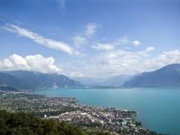
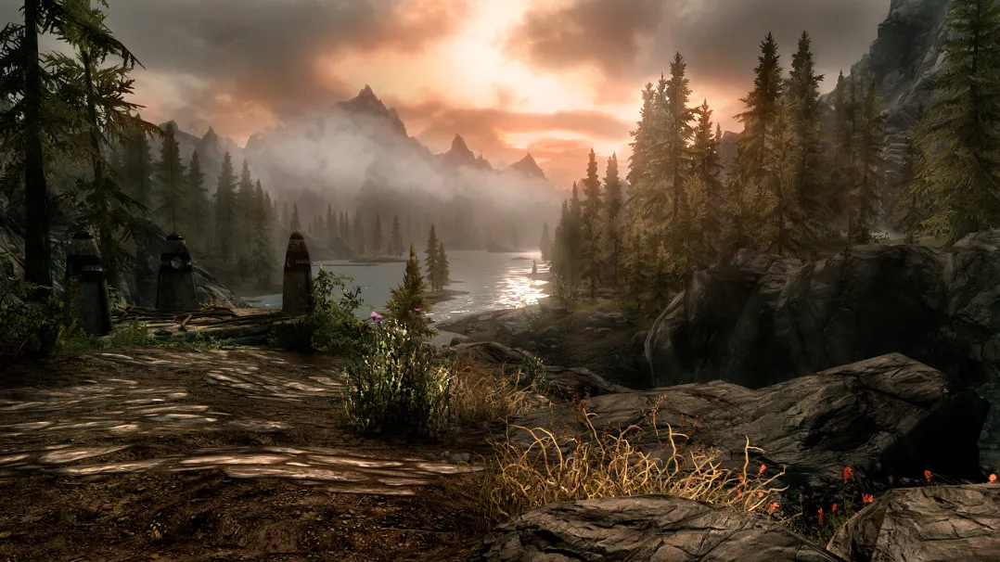
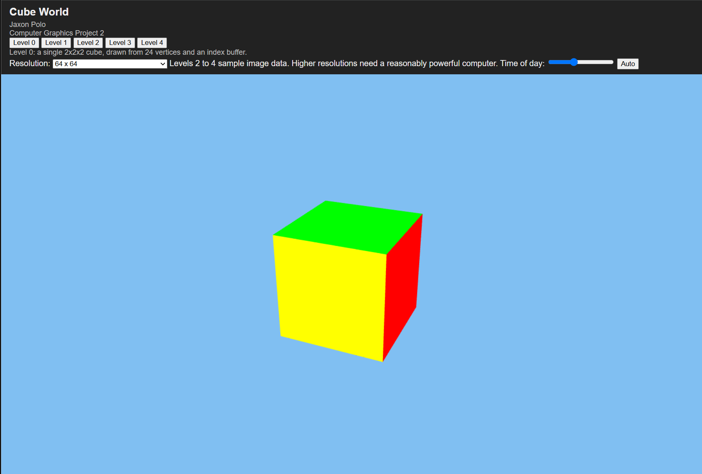
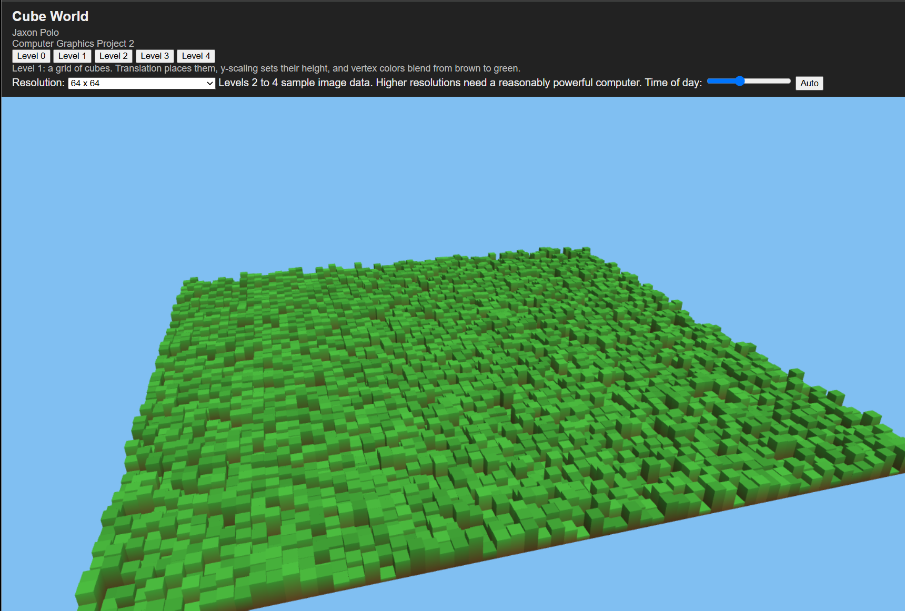
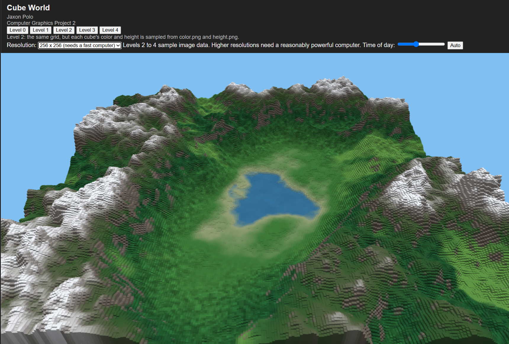
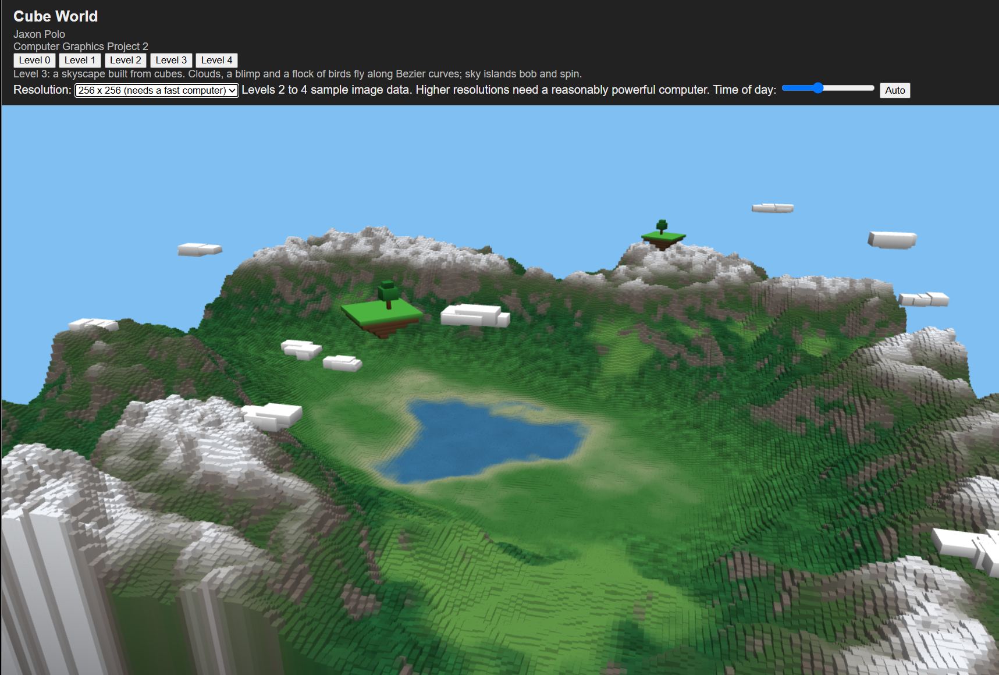
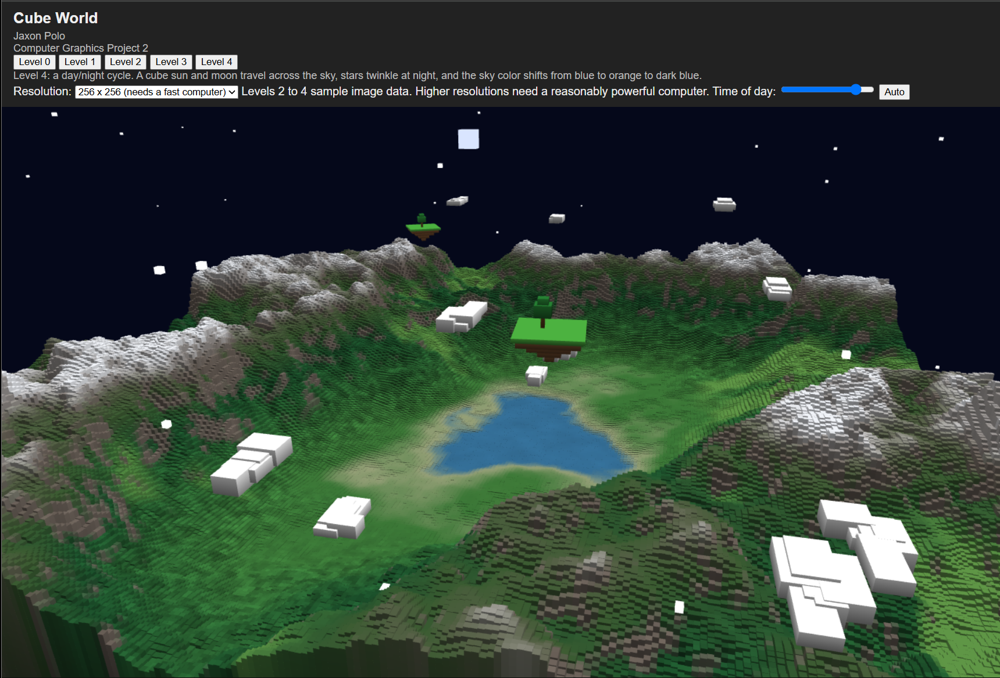

# Project 2: Cube World - Design and Documentation

## Design

The project is a medieval mountain pass built entirely from scaled, translated, and rotated cubes. 
There are
also clouds and floating islands floating above the landscape. The only model that everything is built 
with is just a 2x2x2 cube drawn many times with different transformation matrices.

**Inspiration**

The landscape is inspired by Lake Geneva in Switzerland, where mountains rase from the water, and 
medieval landscapes like those in Skyrim and similar games. 




**Experience**

- The camera orbits the landscape and always looks at its center, so the viewer sees the landscape from
every side without any input.
- The ground is a grid of cube columns. Each column's height comes from a grayscale height map and its
color from a color map, so mountains rise and the lake sits lower.
- The sky layer sits above the terrain. Clouds drift across on curved paths and two sky islands, each
with a tree, bob up and down and slowly turn.
- The viewer can raise the image resolution from low to high, so the scene works on weaker laptops and
looks sharper on stronger ones.

**Design Choices**

- Faces get different brightness values (top brightest, bottom darkest) so the cubes read as solid
shapes without a lighting system
- Clouds and islands use cubes of different and varied sizes so they look different from the landscape,
  but all still come from the shared cube object.
- Sky objects sit above the landscape with some clouds being able to touch the top of the mountains.

## Project Overview

Cube World is a WebGL application written in plain JavaScript, HTML and CSS with no graphics 
frameworks. It is hosted publicly on Vercel and deploys from the `main` branch.

| Item | Link |
| --- | --- |
| Live application | [computer-graphics-project-2.vercel.app](https://computer-graphics-project-2.vercel.app/) |
| Source code | [Project 2 GitHub link](https://github.com/polojb/Computer-Graphics-Projects/tree/main/Project_2) |
| Live Demo | [Demo Video]() |

The code is split into one file per level:
 
- **Level 0:** page header and a single 2x2x2 cube.
- **Level 1:** procedural cube grid with scaled heights, vertex colors and an orbiting camera.
- **Level 2:** landscape driven by a color image and a height map image, with selectable resolution.
- **Level 3:** skyscape of clouds and floating islands moving on Bezier curves.
- **Level 4:** a day and night cycle with a moving sun and moon, a sky that changes
color, and twinkling stars.

## Features and Controls

The viewer picks a level from the tabs. Add a screenshot under each feature below.
 
| Feature | What the viewer sees | Control |
| --- | --- | --- |
| Level tabs | Switch between the project levels | Level 0 to Level 4 buttons in the header |
| Orbiting camera | The camera circles the landscape, always looking at its center | Automatic |
| Procedural grid | A grid of cube columns with varied heights and colors | None (fixed 64 x 64 grid) |
| Image landscape | Terrain colored and shaped from the color map and height map | Resolution dropdown (32, 64, 128, 256) |
| Skyscape | Six clouds drifting on curved paths, two bobbing and turning sky islands | Automatic |
| Day and night | A sun and moon cross the sky, the sky changes color, and stars twinkle at night | Time of day slider, auto button |
 
**Level 0: single cube**



**Level 1: procedural grid**



**Level 2: landscape from images**



**Level 3: skyscape**



**Level 4: day and night**




## How it Works

Every object in the world is the same cube mesh drawn with a different model matrix, so the project is
mostly about building the right transformation for each draw call.

### The cube as vertices and triangles 

The cube has 24 vertices (4 per face) and 36 indices, which form 12 triangles. A face gets its own 4 
vertices so it can have its own color. Vertex positions run from -1 to 1 on each axis, which makes the 
base cube 2x2x2. The vertices and indices are uploaded to GPU buffers once in `init`, then reused for 
every cube in the scene.

### Vertex colors and interpolation

Each face has a brightness (top 1.0, front 0.8, right 0.7, back 0.6, left 0.5, bottom 0.4), and 
vertices on the lower half of a cube are darkened by a further 0.6. Each object also supplies a tint 
color through the `uTint` uniform. The vertex shader multiplies the vertex color by the tint, and the 
rasterizer interpolates that color across each triangle before the fragment shader outputs it. This 
gives gradients on the sides of tall columns without a lighting model.
 
Level 1 colors its vertices differently: the bottom four vertices of a cube are brown (0.45, 0.30, 
0.15) and the top four are green (0.30, 0.75, 0.25), each multiplied by the face brightness. Because
the fragment shader interpolates between vertices, the side faces fade smoothly from brown to green.
Each cube also gets a random tint between 0.8 and 1.0 for variety.

### Transformation and the model matrix

The code builds 4x4 matrices for translate, scale and rotate about each axis, stored column-major in 
`Float32Array`s as WebGL expects. A cube's model matrix is composed as:
 
```math
M = T \cdot R_z \cdot R_y \cdot R_x \cdot S
```
 
Matrices apply right to left, so the cube is first scaled to its size, then rotated, then moved into
place. Terrain columns use only translation and a y-scale (Level 1 and 2). Sky objects use all three.

### Objects built from several cubes

A cloud or island is a list of parts, each with a position, scale, rotation and tint. `drawParts` 
builds each part's local matrix, then multiplies it by the whole object's matrix: `objectMatrix * 
localMatrix`. Moving or scaling the object matrix therefore moves or scales every part together. A 
cloud is 4 to 6 randomly sized cubes. An island is 8 cubes: a grass top, four shrinking dirt layers
underneath, a trunk and two leaf cubes.

### Camera and projection

The vertex shader computes `gl_Position = uProj * uView * uModel * vec4(aPosition, 1.0)`. This is the
pinhole camera pipeline from Project 1: the model matrix places the cube in the world, the view matrix
moves the world so the camera is at the origin, and the projection matrix divides by depth so distant 
cubes look smaller. The camera object supplies `view` and `proj`, and the camera path orbits the 
landscape while looking at its center. Depth testing is turned on once in `main.js` with 
`gl.enable(gl.DEPTH_TEST)`, and the depth buffer is cleared every frame. It keeps near cubes in front 
of far ones, the same job as the z-buffer in Project 1.

### The orbiting camera
 
`lookAt(eye, target)` in `main.js` builds the view matrix. The z axis points from the target to the 
eye, the x axis is horizontal and perpendicular to it, and y completes the set. The last row holds the 
negative dot product of each axis with the eye position, which moves the eye to the origin. 
`perspective(aspect)` uses a 45 degree vertical field of view, a near plane at 0.1 and a far plane at
500.
 
Every frame the eye moves around a circle: `eye = (r cos θ, h, r sin θ)`, and θ grows by `speed * dt`,
with `dt` capped at 0.1 seconds so a slow frame does not make the camera jump. Each level has its own 
camera:
 
| Level | Radius r | Height h | Look-at point | Speed (rad/s) |
| --- | --- | --- | --- | --- |
| 0 | 8 | 4 | (0, 0, 0) | 0.4 |
| 1 | 130 | 62 | (0, 0, 0) | 0.2 |
| 2 | 200 | 150 | (0, 0, 0) | 0.2 |
| 3 and 4 | 200 | 100 | (0, 16, 0) | 0.12 |
 
The levels stack. The Level 3 tab draws Level 2's terrain plus the skyscape, and the Level 4 tab draws 
the terrain, the skyscape and the sun, moon and stars, all with the same camera.

### Landscape from images (Level 2)

Two 1024 x 1024 PNG files drive the terrain: `color.png` (RGB) and `height.png` (8-bit grayscale). Each 
is drawn onto an offscreen canvas and read with `getImageData`, which returns a flat array of red, 
green, blue and alpha values for every pixel.
 
The grid is N x N, with N chosen in the Resolution dropdown: 32, 64 (the default), 128 or 256. Cubes 
are spaced `256 / N` apart, so the world is always 256 units wide.
 
**Sampling** Each cube covers a square block of `floor(1024 / N)` pixels, which is 32, 16, 8 or 4 
pixels on a side. The code averages the red, green and blue values in the block, so a cube gets the 
typical color of its area instead of one pixel that may not represent it. A single center-pixel option 
is also in the code (`USE_AVERAGING`).
 
**Height** The averaged red value of the height block is a gray level from 0 to 255. Height = 0.2 + 
(gray / 255) × 50, so black is a thin 0.2 slab and white is 50.2 units tall.
 
**Color** The averaged color, divided by 255, becomes the cube's `uTint`. It multiplies the gray face 
shading in the vertex colors, so the image supplies the hue and the cube's faces supply the light and 
dark.
 
**Placing cubes.** Each model matrix scales x and z by half the spacing and y by half the height, then 
translates to (x, height / 2, z), so every column rests on y = 0. The matrices are computed once, when 
the page loads or the resolution changes, not every frame. Drawing is one `drawElements` call per cube: 
4,096 at 64 x 64 and 65,536 at 256 x 256, which is why the largest option needs a fast computer.
 
Level 1 uses the same placement with a fixed 64 x 64 grid, a spacing of 2 and random heights from 0.5 
to 4.5.

### Level 4 experiments

Level 4 adds a day and night cycle. The sun, moon and stars are cubes, and the sky color is computed 
from the time of day.
 
**Time of day** One full 24-hour day lasts 60 seconds and starts at 9:00. A slider sets the time by 
hand, and an auto button returns to the automatic cycle.
 
**Sun height** The time becomes an angle, `a = ((hours - 6) / 24) * 2π`, so sunrise is at 6:00, the 
sun is overhead at noon and it sets at 18:00. The sine of that angle, `h`, is the sun's height from -1 
to 1. Two blend values come from it:
 
| Value | Formula | Meaning |
| --- | --- | --- |
| `day` | `clamp((h + 0.15) / 0.45)` | 0 at night, 1 in full daylight |
| `warm` | `clamp(1 - abs(h) / 0.25)` | Peaks at sunrise and sunset, 0 otherwise |
 
**Sky color** The sky blends from a night color (0.02, 0.03, 0.10) to a day color (0.55, 0.75, 0.95) 
using `day`, then mixes in a sunset orange (0.95, 0.55, 0.35) at 60% of `warm`. The result is stored in 
`window.skyColor` for the page to use as the background. `main.js` uses it as the background color on 
the Level 4 tab only. The other tabs use a fixed light blue.
 
**Sun and moon** Both are cubes on a dome of radius 150, on opposite sides of the sky. The sun is at 
(150 cos a, 150 sin a, 45) and the moon is at the negated position. Each is drawn only while it is 
above y = 2, so it disappears below the horizon. The sun is a 6-unit yellow cube spinning on two axes, 
and the moon is a 4-unit pale blue cube spinning more slowly.
 
**Stars** 80 star cubes are placed once at startup using a seeded random generator, spread over the 
upper dome. Each star's size is `0.45 * (1 - day) * (0.7 + 0.3 * sin(3t + i))`. The `(1 - day)` factor 
fades stars out as the sky brightens, and the `sin` term makes each one twinkle out of step with the 
others because of its index `i`. Stars smaller than 0.02 are skipped.
 
**Glow** A `uGlow` uniform lets the shader skip the face shading. The vertex shader computes `vColor = 
mix(aColor * uTint, uTint, uGlow)`. With glow at 1, every face of the cube gets the same flat color, so 
the sun, moon and stars look self-lit instead of shaded like the terrain.
 
**Skybox** The sky is a background color plus cubes on a dome, not a textured skybox, which keeps the 
project to the one allowed model.
 
## Bezier curves in the skyscape
 
The clouds move along cubic Bezier curves, which are defined by four control points: P0 and P3 are the 
start and end of the path, and P1 and P2 pull the curve toward them without the curve touching them.
 
```math
B(t) = (1-t)^3 P_0 + 3(1-t)^2 t P_1 + 3(1-t) t^2 P_2 + t^3 P_3, \quad 0 \le t \le 1
```
 
The `bezier` function evaluates this once for each of x, y and z. It computes the four weights `(1-
t)^3`, `3(1-t)^2 t`, `3(1-t)t^2` and `t^3` once, then takes the weighted sum of the control points' 
coordinates. The weights always add up to 1, so the cloud stays inside the shape formed by its control 
points.
 
**Control points** Each cloud gets its own path, generated from a seeded random number generator so the 
scene looks the same on every load:
 
| Point | x | y | z |
| --- | --- | --- | --- |
| P0 | -140 | cloud height (38 to 56) | start depth (-70 to 70) |
| P1 | -50 | height, shifted up to 20 either way | depth, shifted up to 90 either way |
| P2 | 50 | height, shifted up to 20 either way | depth, shifted up to 90 either way |
| P3 | 140 | cloud height | depth, shifted up to 20 either way |
 
Because P1 and P2 are pushed off to the sides independently, paths bend into arcs and S-shapes instead 
of straight lines.
 
**Moving along the curve.** Each cloud's position parameter is `t = (time * speed + offset) % 1`. Speed 
is 0.012 to 0.022 per second, so one pass takes about 45 to 83 seconds. The random offset starts each 
cloud at a different point on its path. The `% 1` wraps `t` back to 0 when a cloud reaches the end, 
which sends it back to its starting spot.
 
**Hiding the reset.** `fadeInOut(t)` returns 0 at the start of the path, ramps to 1 by `t = 0.08`, 
stays at 1, then ramps back to 0 over the last 8% of the path. The cloud's overall scale is multiplied 
by this value, so clouds grow in at one end, shrink away at the other, and reset while invisible.
 
**Other motion.** The two sky islands do not use Bezier curves. Each bobs along y with a sine wave 
(amplitude 1.2) and turns about the y axis at 0.1 radians per second.
 
## Future work
 
- **More sky objects** The skyscape originally had a blimp and a flock of birds following Bezier paths.
These were removed to keep the scene clean, and could return with a heading function that turns each
object to face its direction of travel.
- **Lighting** Face brightness is baked into vertex colors, so shading does not change with the sun or
camera. Adding a directional light and normals would make it feel more three-dimensional.
- **Atmosphere** Distance fog would blend the far terrain into the sky.
- **Performance** Every cube is a separate draw call. Instanced drawing would let the terrain use much
higher resolutions.
- **Bezier terrain** Using Bezier curves to shape the river bed or mountain ridges (Level 3, option 2).

## AI use
 
I used Claude (Anthropic) during this project. It was used in three ways:
 
- **Learning the concepts.** Claude walked me through the ideas behind the project, such as transformation matrices, the Bezier curve function and how the camera works.
- **Level 4.** Claude did most of the work on the day and night cycle, including the sun, moon, stars and sky color.
- **Debugging.** Claude helped me find and fix problems in my code.
